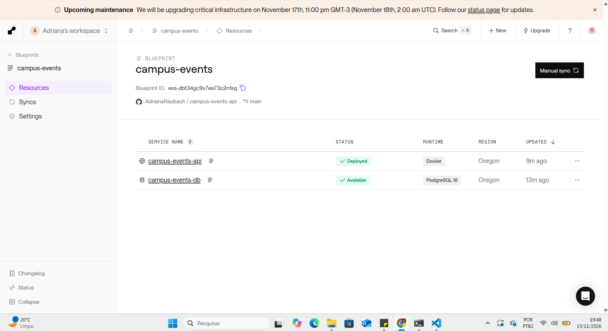
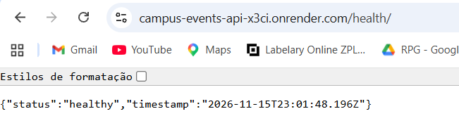
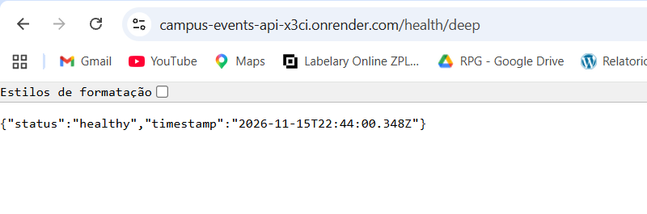
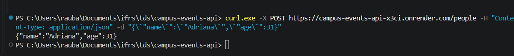
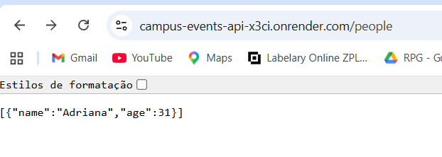

# Node.js API Template

> A Node.js API template with Express, TypeScript and PostgreSQL

[](https://github.com/miikkaylisiurunen/template-node-express/actions/workflows/ci.yml)

## Table of contents

- [Features](#features)
- [How to use](#how-to-use)
  - [Requirements](#requirements)
  - [Getting started](#getting-started)
  - [Scripts](#scripts)
  - [Default routes](#default-routes)
- [Directory structure](#directory-structure)
- [Consistent error handling](#consistent-error-handling)
  - [Throwing consistent errors](#throwing-consistent-errors)
  - [Error handler middleware](#error-handler-middleware)
- [Testing](#testing)
  - [Running tests](#running-tests)
  - [Automated tests](#automated-tests)
- [Continuous integration](#continuous-integration)
- [Deploy (Render)](#deploy-render)

## Features

- Continuous integration with GitHub Actions
- Type safety enforced with TypeScript to minimize errors and improve maintainability
- Custom error handling for better user experience and efficient bug tracking
- Tests powered by [Vitest](https://vitest.dev/) and [Supertest](https://github.com/ladjs/supertest)
- Runtime validation with [Zod](https://zod.dev/) to ensure data quality and consistency
- Database migrations using [node-pg-migrate](https://github.com/salsita/node-pg-migrate) for efficient database management
- Basic request and error logging using [Pino](https://getpino.io/)
- Dockerfile for easy deployment and containerization
- Dependency injection for better testability and decoupling of code components
- Docker Compose for convenient development database setup
- Dependabot integration for automatic npm package updates and improved security
- Code formatting and linting with [Prettier](https://prettier.io) and [ESLint](https://eslint.org/) to improve code quality and consistency
- Environment variable validation

## How to use

### Requirements

- Node.js v20 or higher
- Docker

### Getting started

1. Clone the repository:
   ```
   git clone https://github.com/miikkaylisiurunen/template-node-express.git
   ```
2. Change to the project directory:
   ```
   cd template-node-express
   ```
3. Copy `.env.example` to `.env`:
   ```
   cp .env.example .env
   ```
4. Install npm packages:
   ```
   npm install
   ```
5. Start the database services with Docker Compose:
   ```
   npm run db:up
   ```
6. Start the development server:
   ```
   npm run dev
   ```

**Note:** If you update the database credentials in either the `.env` or `docker-compose.yml` file, be sure to also update the other file with the same changes to ensure that the database can still be accessed correctly.

### Scripts

```
start       # start the production server
dev         # start the development server
build       # build the project using tsc
lint        # find ESLint issues
lint:fix    # fix ESLint issues
test        # run tests
db:up       # start the database services with docker compose
db:down     # stop and remove the database services
```

### Default routes

```
GET /people         # get all people from the database
POST /people        # add a new person with required body properties: "name" and "age"

GET /health         # basic health check (api status)
GET /health/deep    # complete health check (api status + database connection)
```

## Directory structure

```
.
├── .github          # CI workflows and dependabot config to keep npm packages up to date
├── migrations       # database migration scripts
└── src
    ├── controllers  # route controllers
    ├── database     # database queries, tests and file to run migrations
    ├── errors       # custom errors for easier error handling
    ├── middleware   # middleware functions
    └── routes       # routes and their tests
```

## Consistent error handling

### Throwing consistent errors

To ensure consistent error responses and HTTP status codes, use the `HttpError` class when throwing an error. This custom error class is included in the template and provides a straightforward way to throw errors.

### Error handler middleware

An error handling middleware is included to handle and send consistent responses when errors occur. By default, the error response format is as follows:

```json
{
  "status": 401,
  "message": "Unauthorized",
  "name": "HttpError"
}
```

You can specify your own `status` and `message` when using the custom `HttpError` class to throw errors. A catch-all error handler is also included which returns a `500` status code whenever an unhandled error is thrown.

## Testing

This template comes with tests powered by [Vitest](https://vitest.dev) and [Supertest](https://github.com/ladjs/supertest) to ensure the quality and stability of your application through unit and integration testing.

### Running tests

You can manually run tests with the following command:

```
npm test
```

This command will run all tests in the `src` directory and output the results to the console.

### Automated tests

A GitHub Actions workflow is included to automatically run tests. Refer to the [Continuous integration](#continuous-integration) section for more information.

## Continuous integration

This template comes with pre-configured GitHub Actions workflows to automate continuous integration (CI) and ensure that your code is always tested before being merged into the main branch. The workflows run automatically on every push to the `main` branch, or when a pull request is opened, reopened, or synchronized.

The workflows included are:

- `ci.yml` - Runs tests and builds the project, preventing issues and bugs from making their way into production.
- `lint.yml` - Runs ESLint to find linting issues, ensuring that your code is always in compliance with your ESLint rules, which can improve code quality and consistency.

Additionally, a `dependabot.yml` configuration is included and run automatically on a weekly basis. It detects outdated npm packages and creates pull requests to update them, ensuring that your npm packages are always up to date, which can improve security and prevent bugs caused by outdated packages.

## Deploy (Render)

A API foi publicada no [Render](https://render.com) usando o `Dockerfile` e o Blueprint `render.yaml`, com PostgreSQL gerenciado do próprio Render.

**URL pública:** https://campus-events-api-x3ci.onrender.com/

### Como foi publicada

1. Foi feito push do `render.yaml` para a branch `main` no GitHub.
2. No painel do Render, foi usada a opção **New → Blueprint**, selecionando o repositório. O Render criou o web service (`campus-events-api`) e o banco PostgreSQL (`campus-events-db`).
3. Aguardou-se o build e o status **Live**.

### Variáveis de ambiente

| Variável       | Origem                                                                 |
| -------------- | ---------------------------------------------------------------------- |
| `DATABASE_URL` | Preenchida automaticamente pelo Blueprint (connection string do banco) |
| `PORT`         | Definida pelo Render (10000); a aplicação a lê via `process.env.PORT`  |
| `NODE_ENV`     | `production`                                                           |

As migrations rodam automaticamente na inicialização da API (`applyMigrations` em `src/index.ts`).

### Validação após o deploy

Após a publicação, foram validados os endpoints abaixo:

```
https://campus-events-api-x3ci.onrender.com/health        # {"status":"healthy","timestamp":"..."}
https://campus-events-api-x3ci.onrender.com/health/deep   # confirma conexão com o banco
curl.exe -X POST https://campus-events-api-x3ci.onrender.com/people -H "Content-Type: application/json" -d "{\`"name\`":\`"Adriana\`",\`"age\`":31}"
https://campus-events-api-x3ci.onrender.com/people        # lista a pessoa criada (persistida no PostgreSQL)
```

**Observação:** no plano gratuito o serviço "dorme" após inatividade (a primeira requisição pode levar ~1 min) e o banco gratuito expira após 30 dias.

### Evidências





